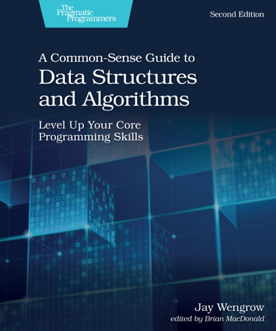

# Practice_CS

Práctica de [C#](https://github.com/dotnet/runtime) y [ASP.Net Core](https://github.com/dotnet/aspnetcore)

## 💻 C# Básico [Fuente](https://toplearn.com/c/gJY) | [Código](https://github.com/alikzalikz/Practice_CS/tree/main/C%23%20Basics)

```markdown
Instituto: TopLearn        Profesor: Iman Madaeny           
Duración: 10.horas         Número de prácticas: 26 
Temas: Switch Case | IfElse | For | GenericList | Static 
        Property | OOP | WinFormSample | Conceptos básicos de SQL Server
```

## 💻 C# Avanzado [Fuente](https://toplearn.com/c/mZO) | [Código](https://github.com/alikzalikz/Practice_CS/tree/main/C%23%20Advanced)

```markdown
Instituto: TopLearn        Profesor: Iman Madaeny           
Duración: 10.horas         Número de prácticas: 
Temas: Linq | 
```


## 📓 CS11Dotnet07 [Fuente](https://a.co/d/1cTUHN6) | [Código](https://github.com/alikzalikz/Practice_CS/tree/main/CS11Dotnet07%20Book)

```markdown
Nombre del libro: C# 11 y .NET 7
Autor: Mark J. Price      Páginas: 819 
Temas: C# | Inicio desarrollo web | Blazor
        EF Core
```



## 📓 Estructuras de Datos y Algoritmos [Fuente](https://a.co/d/3QHz6QU) | [Código](https://github.com/alikzalikz/Practice_CS/tree/main/DS%20%26%20Algorithms%20Book)

```markdown
Nombre del libro: A Common-Sense Guide to Data Structures and Algorithms
Autor: Jay Wengrow      Páginas: 499
Temas: 
```
